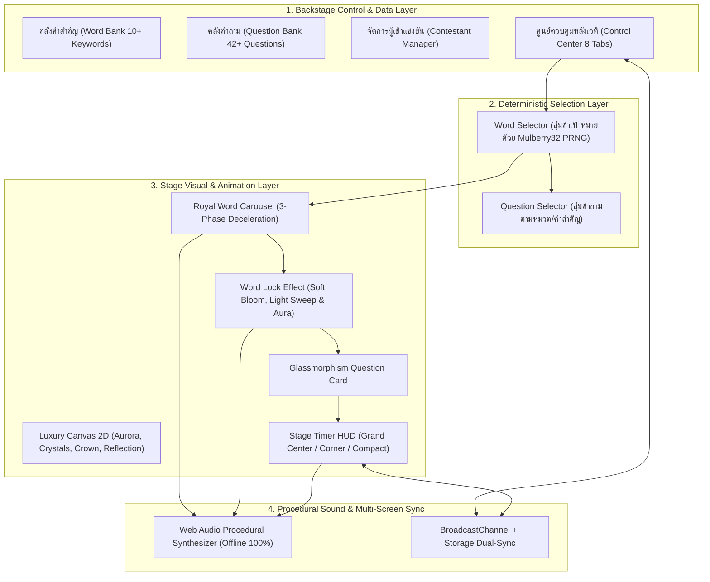
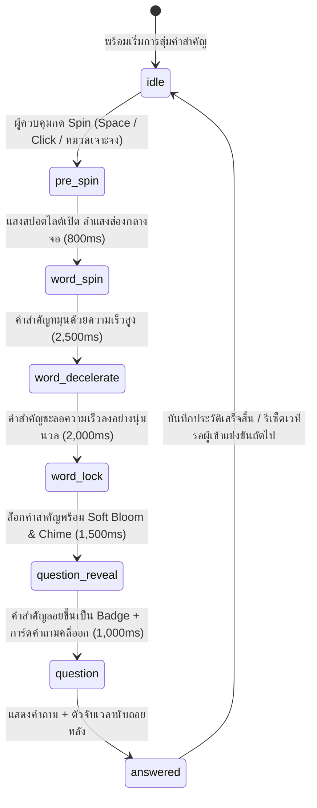

# 👑 เอกสารสรุปการทำงานและโครงสร้างระบบ (Project Technical Summary)
## รอยต่อฤดู — Version 3.0: Royal Word Spin & Luxury Pageant Edition
### ระบบสุ่มและแสดงคำถามสำหรับการประกวดดาว–เดือน (✦ SCi TECH TINE ✦ CHARM OF TRANSITION AMBASSADOR 2026)

---

## 📑 สารบัญ (Table of Contents)

1. [บทนำและแนวคิดของโปรเจกต์ (Executive Summary & Core Vision)](#1-บทนำและแนวคิดของโปรเจกต์-executive-summary--core-vision)
2. [สถาปัตยกรรมระบบและเทคโนโลยี (System Architecture & Tech Stack)](#2-สถาปัตยกรรมระบบและเทคโนโลยี-system-architecture--tech-stack)
3. [วงจร State Machine 8 ลำดับสถานะ (Lifecycle & State Flow)](#3-วงจร-state-machine-8-ลำดับสถานะ-lifecycle--state-flow)
4. [ระบบคลังคำสำคัญและการสุ่มแบบแม่นยำ (Word Bank & Deterministic PRNG)](#4-ระบบคลังคำสำคัญและการสุ่มแบบแม่นยำ-word-bank--deterministic-prng)
5. [ระบบฟิสิกส์บรรยากาศเวทีประกวด (Luxury Pageant Canvas 2D Physics)](#5-ระบบฟิสิกส์บรรยากาศเวทีประกวด-luxury-pageant-canvas-2d-physics)
6. [ระบบเสียงสังเคราะห์ออฟไลน์ (Procedural Web Audio Engine & Sound Synthesis)](#6-ระบบเสียงสังเคราะห์ออฟไลน์-procedural-web-audio-engine--sound-synthesis)
7. [ระบบจับเวลา รูปแบบการจัดวาง และการซิงก์สองหน้าจอ (Timer, HUD Modes & Sync)](#7-ระบบจับเวลา-รูปแบบการจัดวาง-และการซิงก์สองหน้าจอ-timer-hud-modes--sync)
8. [ศูนย์ควบคุมการแข่งขันหลังเวที (Competition Control Center 8 Tabs)](#8-ศูนย์ควบคุมการแข่งขันหลังเวที-competition-control-center-8-tabs)
9. [โครงสร้างไดเรกทอรีและหน้าที่ของแต่ละไฟล์ (Project Directory Tree)](#9-โครงสร้างไดเรกทอรีและหน้าที่ของแต่ละไฟล์-project-directory-tree)
10. [การจัดเก็บข้อมูลและการสำรองข้อมูล (Data Storage & LocalStorage Namespaces)](#10-การจัดเก็บข้อมูลและการสำรองข้อมูล-data-storage--localstorage-namespaces)
11. [คู่มือการใช้งานและคีย์ลัดบนเวที (Operations & Keyboard Shortcuts)](#11-คู่มือการใช้งานและคีย์ลัดบนเวที-operations--keyboard-shortcuts)
12. [รายงานผลการทดสอบและการประกันคุณภาพ (QA Testing Report)](#12-รายงานผลการทดสอบและการประกันคุณภาพ-qa-testing-report)

---

## 1. บทนำและแนวคิดของโปรเจกต์ (Executive Summary & Core Vision)

**“รอยต่อฤดู — Royal Word Spin & Luxury Pageant Edition” (Version 3.0)** คือเว็บแอปพลิเคชันเกรดพรีเมียมสำหรับใช้บนเวทีกิจกรรมประกวดดาว–เดือน (✦ SCi TECH TINE ✦ CHARM OF TRANSITION AMBASSADOR 2026) 

### 💎 ปรัชญาการออกแบบ (Core Design Philosophy)
- **Royal Word Spin (การหมุนคำสำคัญระดับพรีเมียม):** ปฏิเสธระบบสล็อตหรือกล้องสุ่มแบบเกมโชว์ แต่ใช้ **“Royal Word Carousel”** ที่หมุนคำสำคัญเชิงคุณค่า (เช่น *ความฝัน, วิสัยทัศน์, ภาวะผู้นำ, ตัวตน, คุณค่า, การปรับตัว, พันธกิจ*) ผ่านแกนกลางเวทีอย่างสง่างาม
- **Deterministic Selection (สุ่มก่อน-แสดงผลตาม):** ระบบคำนวณผลลัพธ์คำสำคัญและคำถามเป้าหมายล่วงหน้าด้วย Mulberry32 PRNG แล้วขับเคลื่อนแอนิเมชันให้ชะลอความเร็ว (3-Phase Deceleration) และล็อกคำเป้าหมายได้อย่างแม่นยำ 100%
- **Luxury Winter Pageant Atmosphere:** ผสานบรรยากาศปลายฝนต้นหนาวเข้ากับธีมเวทีประกวดระดับจักรวาล: โทนสี Deep Navy (`#071126`), Royal Blue (`#0D2854`), Violet Glow (`#5B4BDB`), Silver Light (`#DDE7FF`), Soft Gold (`#F5D98A`), ม่านแสงออโรร่าพริ้วไหว, ฝุ่นคริสตัลระยิบระยับ, โครงร่างมงกุฎโปร่งแสง, และแสงสะท้อนผิวน้ำ
- **100% Offline Capability & Dual-Screen Sync:** ทำงานได้สมบูรณ์โดยไม่ต้องต่ออินเทอร์เน็ต ทั้งระบบเรนเดอร์ Canvas 2D และสังเคราะห์คลื่นเสียงสดด้วย Web Audio API พร้อมซิงก์สองหน้าจอผ่าน `BroadcastChannel`

---

## 2. สถาปัตยกรรมระบบและเทคโนโลยี (System Architecture & Tech Stack)

ระบบถูกออกแบบด้วยสถาปัตยกรรม **Decoupled Modular Architecture** แยกส่วนตรรกะการคำนวณ, กราฟิกฟิสิกส์, การสังเคราะห์เสียง, และส่วนติดต่อผู้ใช้งานออกจากกันอย่างอิสระ:



### 🛠️ เทคโนโลยีหลักที่ใช้
| ส่วนงาน | เทคโนโลยีที่เลือกใช้ | จุดเด่น |
| :--- | :--- | :--- |
| **Core Framework** | React 19 + TypeScript | UI State Management ประสิทธิภาพสูง พร้อม Type-safety 100% |
| **Build Tool** | Vite 6 | บิลด์รวดเร็ว Hot Module Replacement (HMR) ทันใจ |
| **Graphics Engine** | HTML5 Canvas 2D Context | รันแอนิเมชันอนุภาคแสงและฟิสิกส์ 60fps ลื่นไหล ไม่กิน DOM |
| **Sound Engine** | Web Audio API (Procedural) | สังเคราะห์เสียงจริงแบบ Offline 100% ไม่ต้องใช้ไฟล์ MP3 |
| **Multi-Screen Sync** | BroadcastChannel + Storage Events | ซิงก์ข้อมูลข้ามหน้าต่าง/แท็บแบบ Realtime ความเร็วระดับมิลลิวินาที |
| **Data Persistence** | LocalStorage + JSON Schema | บันทึกข้อมูลคลังคำ คลังคำถาม ผู้เข้าแข่งขัน และ Audit Log |
| **Testing Suite** | Vitest + Happy DOM | ชุดทดสอบ 13 Test Suites รวม 69 การทดสอบ (ผ่าน 100%) |

---

## 3. วงจร State Machine 8 ลำดับสถานะ (Lifecycle & State Flow)

ระบบทำงานผ่าน **Deterministic Finite State Machine (FSM)** ที่ร้อยเรียงลำดับการสุ่มคำสำคัญ 8 สถานะ รวมเวลาแอนิเมชันประมาณ **7.8 วินาที** ก่อนเปิดเผยคำถาม:



### 📋 รายละเอียดแต่ละสถานะ (State Descriptions & Durations)

| # | State Name | Duration | ภาพบนเวที (Visual Scene) | เสียงสังเคราะห์ (Soundscape) |
|---|---|:---:|---|---|
| **0** | `idle` | ∞ | สแตนด์บาย แสงออโรร่าพริ้วไหว ละอองคริสตัลระยิบระยับ มงกุฎโปร่งแสง | เสียงเงียบสงบ (Ambient Silence) |
| **1** | `pre-spin` | 800ms | ลำแสง Light Beam ส่องลงมาตรงกลาง การ์ดคำเริ่มลอยตัวเตรียมพร้อม | เสียง Wind & Chime สะสมพลัง (Charge-up Whoosh) |
| **2** | `word-spin` | 2,500ms | คำสำคัญหมุนผ่านแกนกลางด้วยความเร็วสูง (High Speed Spin) | จังหวะ Tick ถี่เร็วต่อเนื่อง (Accelerating Ticks) |
| **3** | `word-decelerate`| 2,000ms | ความเร็วในการหมุนค่อยๆ ชะลอลงอย่างนุ่มนวล มองเห็นคำชัดขึ้นทีละคำ | จังหวะ Tick ชะลอลงทีละสเต็ป กังวานขึ้น |
| **4** | `word-lock` | 1,500ms | ล็อกคำสำคัญตรงกลาง พร้อม Soft Bloom, Light Sweep, และ Particle Burst | ระฆังคู่ Chime ดังกังวาน (Lock Ethereal Chime) |
| **5** | `question-reveal`| 1,000ms | คำสำคัญลอยขึ้นเป็น Badge ด้านบน และการ์ดคำถามคลี่ออกอย่างสง่างาม | คอร์ด Harmonic Reveal (C Major 7th) |
| **6** | `question` | ∞ | แสดงข้อความคำถามขนาดใหญ่ ป้ายผู้เข้าแข่งขัน และตัวจับเวลา | เสียงตัวจับเวลาเดิน / สัญญาณเตือน |
| **7** | `answered` | ∞ | ป้ายแสดงสถานะตอบเสร็จสิ้น บันทึกประวัติลง Audit Log | สัญญาณจบ |

---

## 4. ระบบคลังคำสำคัญและการสุ่มแบบแม่นยำ (Word Bank & Deterministic PRNG)

ระบบแยก **Word Pool (คลังคำสำคัญ)** ออกจาก **Question Pool (คลังคำถาม)** อย่างชัดเจน:

### 🌟 รายการคำสำคัญเริ่มต้น (Default Keywords)
1. 🌙 **ความฝัน** (*Authenticity & Empathy*) — หมวด Moon (`#e2e8f0`)
2. 🌫️ **วิสัยทัศน์** (*Vision & Perspective*) — หมวด Mist (`#94a3b8`)
3. 🍃 **ภาวะผู้นำ** (*Leadership & Impact*) — หมวด Wind (`#86efac`)
4. ⭐ **ตัวตน** (*Character & Leadership*) — หมวด Star (`#fde047`)
5. 👑 **คุณค่า** (*Final Decisive Question*) — หมวด Final (`#f43f5e`)
6. 🌧️ **การปรับตัว** (*Adaptability & Growth*) — หมวด Rain (`#38bdf8`)
7. 🍂 **พันธกิจ** (*Purpose & Legacy*) — หมวด Leaf (`#fbbf24`)
8. 🍃 **แรงบันดาลใจ** (*Leadership & Impact*) — หมวด Wind (`#86efac`)
9. ⭐ **ความกล้า** (*Character & Leadership*) — หมวด Star (`#fde047`)
10. 🌫️ **อนาคต** (*Vision & Perspective*) — หมวด Mist (`#94a3b8`)

---

## 5. ระบบฟิสิกส์บรรยากาศเวทีประกวด (Luxury Pageant Canvas 2D Physics)

กราฟิกบนเวทีถูกขับเคลื่อนด้วย **HTML5 Canvas 2D Context** แบบ 6-Layer Cinematic Environment:

```text
src/components/Stage/canvas/
├── AuroraSystem.ts                # ม่านแสงออโรร่าสีน้ำเงิน-ม่วงพริ้วไหวแบบไซน์ (Sinusoidal Waves)
├── CrystalSystem.ts               # ฝุ่นคริสตัลระยิบระยับลอยตัว 2D/3D และโบเก้ (Twinkle & Parallax)
├── CrownSystem.ts                 # โครงร่างมงกุฎคริสตัลโปร่งแสงประดับกึ่งกลาง (Crown Silhouette)
├── ReflectionSystem.ts            # แสงสะท้อนผิวน้ำที่ขอบจอด้านล่าง (Water Mirror Reflection)
├── TransitionLightingSystem.ts    # สปอตไลต์เวทีและ Dynamic Vignette
└── particleTypes.ts               # โครงสร้างข้อมูลอนุภาค
```

---

## 6. ระบบเสียงสังเคราะห์ออฟไลน์ (Procedural Web Audio Engine & Sound Synthesis)

ระบบใช้ `AudioContext` ของ **Web Audio API** ในการสร้างคลื่นเสียงขึ้นมาสดๆ ในเบราว์เซอร์ **100% ออฟไลน์ ไม่ต้องเชื่อมต่ออินเทอร์เน็ต และไม่ต้องใช้ไฟล์ MP3**:

- `playSpinStart()`: เสียงลมกวาดและคลื่นเสียงความถี่ก้าวหน้า (Whoosh & Harmonic Rise)
- `playSpinTick(speedRatio)`: เสียงคลิกติ๊กคริสตัลปรับระดับเสียงตามความเร็วการหมุน
- `playWordLock()`: เสียงระฆังคู่ประสานคอร์ดเมเจอร์และเบสพัลส์นุ่มนวล
- `playQuestionReveal()`: คอร์ด Harmonic Reveal ชัดเจน (C Major 7th)
- `playTickSound(seconds)`: เสียงติ๊กนับถอยหลัง / เสียงเตือน $\le 10$s / ระฆังคู่ $\le 3$s
- `playTimerFinish()`: เสียงระฆังกังวานเมื่อหมดเวลา

---

## 7. ระบบจับเวลา รูปแบบการจัดวาง และการซิงก์สองหน้าจอ (Timer, HUD Modes & Sync)

### ⏱️ Timestamp-based Timer Architecture
การคำนวณเวลานับถอยหลังใช้วิธีส่งคู่ข้อมูล Timestamp:
$$\text{RemainingMs} = \max(0, \text{durationMs} - (\text{Date.now()} - \text{startTimestamp}))$$

### 📐 รูปแบบการจัดวางตัวนับเวลาบนเวที (Stage Display Modes)
1. **จอใหญ่ตรงกลาง (Grand Center Focus):** กล่องนาฬิกาขนาดยักษ์จัดกึ่งกลางจอเหนือการ์ดคำถาม พร้อมแอนิเมชัน `center-timer-reveal`
2. **มุมขวาบน (Corner HUD):** ป้ายดิจิทัลลอยตัวที่มุมขวาบนแบบคลาสสิก
3. **แถบกะทัดรัด (Compact Capsule HUD):** แคปซูลนาฬิกาแนวนอนขนาดกะทัดรัด

---

## 8. ศูนย์ควบคุมการแข่งขันหลังเวที (Competition Control Center 8 Tabs)

ศูนย์ควบคุมหลังเวทีรองรับการทำงาน 8 แท็บ:
1. **ควบคุมเวที (Stage Control):** ปุ่ม ✦ SPIN WORD ✦, ปุ่มสุ่มเจาะจงคำสำคัญ, เลือกผู้เข้าแข่งขัน, เลือกรอบ, ควบคุมตัวจับเวลา, มอนิเตอร์ Live
2. **คลังคำสำคัญ (Word Bank):** จัดการคำสำคัญ 10+ คำ, ผูกหมวดหมู่, สลับเปิด/ปิดใช้งาน, แสดงจำนวนคำถามที่เชื่อมโยง
3. **คลังคำถาม (Question Bank):** ตารางคำถาม CRUD, ค้นหา, กรองหมวดหมู่/รอบ/ความยาก, นำเข้าและส่งออก JSON
4. **ตัวจับเวลา (Timer Panel):** ตั้งเวลา Preset (`30s`, `1m`, `1m30s`, `2m`), Custom, สวิตช์เปิด/ปิดเสียง 3 ประเภท, ปรับโหมดจัดวาง
5. **ผู้เข้าแข่งขัน (Contestant Manager):** จัดการรายชื่อ หมายเลข คณะ และตำแหน่ง
6. **ตรวจสอบประวัติ (History Audit Log):** บันทึกเวลาที่ใช้ คำสำคัญ คำถาม และส่งออก CSV / JSON
7. **ปรับแต่งหน้าตา (Appearance Settings):** เลือกรูปแบบการหมุน (Vertical, 3D, Orbital, Ribbon), ปรับความหนาแน่นคริสตัล, ความสว่างออโรร่า, เปิด/ปิดมงกุฎและแสงสะท้อน

---

## 9. โครงสร้างไดเรกทอรีและหน้าที่ของแต่ละไฟล์ (Project Directory Tree)

```text
d:/Drive D/Project/RandomizeQuiz/
├── index.html                     # จุดเริ่มต้น HTML5 พร้อมฟอนต์ Google Fonts (Cinzel, Outfit, Bai Jamjuree)
├── package.json                   # การกำหนด Dependencies และ Scripts (Vite, React 19, Vitest, Lucide)
├── tsconfig.json                  # การตั้งค่า TypeScript Compiler (Strict Mode)
├── vite.config.ts                 # การตั้งค่า Vite Build Tool & React Plugin
│
├── src/
│   ├── main.tsx                   # จุดเมานต์ React Root
│   ├── App.tsx                    # คอมโพเนนต์หลัก จัดการ Stage View และ Remote Controller
│   ├── index.css                  # Design Tokens, Glassmorphism, Keyframes, Animations (~36KB)
│   │
│   ├── components/
│   │   ├── Stage/                 # องค์ประกอบจอเวทีหลัก (Stage View)
│   │   │   ├── StageCanvas.tsx    # Canvas 2D Render Loop (Aurora, Crystal, Crown, Reflection)
│   │   │   ├── StageOverlay.tsx   # UI Layer ซ้อนทับบน Canvas
│   │   │   ├── QuestionCard.tsx   # การ์ดแสดงคำถามพร้อม Glassmorphism และ Badge
│   │   │   ├── StageHeader.tsx    # แถบหัวเวที "✦ SCi TECH TINE ✦ CHARM OF TRANSITION AMBASSADOR 2026"
│   │   │   ├── ContestantBadge.tsx# ป้ายแสดงข้อมูลผู้เข้าแข่งขันบนการ์ด
│   │   │   ├── TimerDisplay.tsx   # ตัวแสดงเวลานับถอยหลัง 3 รูปแบบ (Center, Corner, Compact)
│   │   │   ├── WordSpin/          # โมดูลหมุนคำสำคัญและเอฟเฟกต์ล็อกคำ
│   │   │   │   ├── WordCarousel.tsx
│   │   │   │   └── WordLockEffect.tsx
│   │   │   └── canvas/            # โมดูลฟิสิกส์อนุภาคและแสงบน Canvas
│   │   │       ├── AuroraSystem.ts
│   │   │       ├── CrystalSystem.ts
│   │   │       ├── CrownSystem.ts
│   │   │       ├── ReflectionSystem.ts
│   │   │       ├── RainSystem.ts
│   │   │       ├── WaterDropSystem.ts
│   │   │       ├── MistSystem.ts
│   │   │       ├── LeafSystem.ts
│   │   │       ├── SkySystem.ts
│   │   │       ├── TransitionLightingSystem.ts
│   │   │       └── particleTypes.ts
│   │   │
│   │   └── Control/               # องค์ประกอบศูนย์ควบคุม (Control Center)
│   │       ├── ControlCenter.tsx  # Dashboard หลักแบบ 8 แท็บ
│   │       ├── ControlDrawer.tsx  # แผง Drawer สไลด์ข้างบนหน้าจอเวที
│   │       ├── RemoteController.tsx # หน้าต่างควบคุมเฉพาะกิจ (?mode=controller)
│   │       ├── KeyboardController.tsx # ตัวดักจับ Keyboard Shortcuts
│   │       ├── WordBankDashboard.tsx  # แดชบอร์ดคลังคำสำคัญ
│   │       ├── WordManagerModal.tsx   # โมดอล CRUD คำสำคัญ
│   │       ├── QuestionBankDashboard.tsx # ตารางและสถิติคลังคำถาม
│   │       ├── QuestionManagerModal.tsx  # โมดอล CRUD คำถาม
│   │       ├── ContestantManagerModal.tsx# โมดอล CRUD ผู้เข้าแข่งขัน
│   │       ├── TimerPanel.tsx     # แผงควบคุมตัวจับเวลาและเสียง
│   │       ├── AppearanceSettings.tsx # แผงปรับแต่งธีมและการแสดงผล
│   │       └── HistoryPanel.tsx   # แผงตรวจสอบและส่งออกประวัติ
│   │
│   ├── engine/                    # Core Pure Logic Engines
│   │   ├── stateMachine.ts        # FSM 8 ลำดับสถานะ และ Timing (~7.8s)
│   │   ├── prng.ts                # Mulberry32 PRNG Algorithm
│   │   ├── wordSelector.ts        # ตัวคัดเลือกคำสำคัญ (Filter, Category, PRNG)
│   │   ├── wordSpinEngine.ts      # สร้าง Reel คำ และคำนวณ Deceleration Easing
│   │   ├── questionSelector.ts    # ตัวคัดเลือกคำถาม (Filter, Deduplicate, PRNG)
│   │   ├── timerEngine.ts         # การคำนวณเวลานับถอยหลังและ Warning Cue
│   │   ├── audioEngine.ts         # Web Audio API Procedural Sound Synthesizer
│   │   └── historyManager.ts      # บันทึก Audit Log และ Export CSV / JSON
│   │
│   ├── hooks/                     # Custom React Hooks
│   │   ├── useStageSync.ts        # Two-Way Sync ผ่าน BroadcastChannel & Storage Event
│   │   └── useTimer.ts            # Timer Lifecycle และ Tick Events
│   │
│   ├── types/                     # TypeScript Type Definitions
│   │   ├── session.ts             # SessionState, AppState, SyncMessage
│   │   ├── question.ts            # Question, Contestant, CategoryConfig, CATEGORY_CONFIGS
│   │   ├── word.ts                # KeywordItem, WordBankState, WordSpinMode
│   │   ├── appearance.ts          # AppearanceSettings, ThemeColors, DEFAULT_APPEARANCE_SETTINGS
│   │   ├── timer.ts               # TimerState, TimerPreset, TimerSoundSettings, StageDisplaySettings
│   │   └── history.ts             # HistoryRecord, HistoryResult
│   │
│   ├── data/                      # ฐานข้อมูลเริ่มต้น
│   │   ├── defaultQuestions.ts    # คลังคำถามเริ่มต้น 42 ข้อ 7 หมวดหมู่
│   │   ├── defaultContestants.ts  # รายชื่อผู้เข้าแข่งขันเริ่มต้น 10 คน
│   │   └── defaultWords.ts        # คลังคำสำคัญเริ่มต้น 10 คำ
│   │
│   └── utils/
│       └── storage.ts             # Multi-Namespace LocalStorage Manager & Validator
│
└── tests/                         # ชุดการทดสอบอัตโนมัติ (Vitest)
    ├── setup.test.ts
    ├── timerEngine.test.ts
    ├── audioEngine.test.ts
    ├── stateMachine.test.ts
    ├── leafSystem.test.ts
    ├── prng.test.ts
    ├── wordSelector.test.ts
    ├── wordSpinEngine.test.ts
    ├── questionSelector.test.ts
    ├── historyManager.test.ts
    ├── data.test.ts
    ├── storage.test.ts
    └── e2e.test.ts
```

---

## 10. การจัดเก็บข้อมูลและการสำรองข้อมูล (Data Storage & LocalStorage Namespaces)

```typescript
export const STORAGE_KEYS = {
  QUESTIONS:   'season_transition_questions',   // คลังคำถาม
  CONTESTANTS: 'season_transition_contestants', // รายชื่อผู้เข้าแข่งขัน
  WORDS:       'season_transition_words',       // คลังคำสำคัญ
  SESSION:     'season_transition_session',     // สถานะเวทีปัจจุบัน
  HISTORY:     'season_transition_history',     // ประวัติการตอบคำถาม
  SETTINGS:    'season_transition_settings',    // การตั้งค่าเสียงและการจัดวาง
  APPEARANCE:  'season_transition_appearance'   // การตั้งค่าธีมและโหมดวงหมุน
} as const;
```

---

## 11. คู่มือการใช้งานและคีย์ลัดบนเวที (Operations & Keyboard Shortcuts)

### ⌨️ คีย์ลัดบนเวที (Keyboard Shortcuts)
| ปุ่ม (Key) | หน้าที่การทำงาน (Action) |
| :---: | :--- |
| <kbd>Space</kbd> | **เริ่มการหมุนคำ (✦ SPIN WORD ✦)** หรือ **หยุดชั่วคราว (Pause & Resume)** |
| <kbd>Enter</kbd> | **ข้ามไปคำถาม (Skip)** หรือ **บันทึกว่าตอบแล้ว (Done)** |
| <kbd>T</kbd> | **เริ่ม / หยุดตัวจับเวลา (Start / Pause Timer)** |
| <kbd>Esc</kbd> | **เปิด / ปิดแผงควบคุมด้านข้าง (Toggle Control Drawer)** |
| <kbd>M</kbd> | **เปิด / ปิดเสียงบรรยากาศ (Toggle Mute/Unmute)** |
| <kbd>F</kbd> | **เข้า / ออกโหมดเต็มหน้าจอ (Toggle Fullscreen)** |

---

## 12. รายงานผลการทดสอบและการประกันคุณภาพ (QA Testing Report)

โปรเจกต์ผ่านการทดสอบแบบ Automated Test ครอบคลุมทุกส่วนของระบบด้วย **Vitest** จำนวน **13 Test Suites รวมทั้งสิ้น 69 Tests (ผ่าน 100%)**:

```text
 ✓ tests/historyManager.test.ts (4 tests)
 ✓ tests/prng.test.ts (5 tests)
 ✓ tests/audioEngine.test.ts (6 tests)
 ✓ tests/timerEngine.test.ts (10 tests)
 ✓ tests/questionSelector.test.ts (4 tests)
 ✓ tests/stateMachine.test.ts (4 tests)
 ✓ tests/wordSpinEngine.test.ts (3 tests)
 ✓ tests/leafSystem.test.ts (4 tests)
 ✓ tests/data.test.ts (6 tests)
 ✓ tests/storage.test.ts (12 tests)
 ✓ tests/e2e.test.ts (5 tests)
 ✓ tests/setup.test.ts (2 tests)
 ✓ tests/wordSelector.test.ts (4 tests)

 Test Files  13 passed (13)
      Tests  69 passed (69)
   Duration  ~3.6s
```

---

## 13. การปรับปรุงระบบจับเวลาเวทีประกวดระดับพรีเมียม (Ultra-Clean Royal Pageant Timer)

ได้รับการปรับแต่งเอฟเฟกต์ความลื่นไหลระดับ 60fps และระบบเสียงบรรยากาศเวทีประกวด:
1. **Ultra-Clean & Non-Flashing Theme (นิ่งสนิท ไร้การกะพริบ):**
   - รวมโทนสีการ์ดนับเวลาเป็นหนึ่งเดียวคงที่ตลอดการนับเวลา (`Deep Navy Glassmorphism` + `Royal Cyan Border`)
   - ป้ายสถานะแสดง `⏱️ กำลังนับเวลา` อย่างคงที่ ไม่สลับข้อความเตือนถี่ๆ ให้ลายตา
   - ตัวเลขนับเวลาคมชัดสูง (`#FFFFFF` คมกริบ) ไร้เงาเบลอหนาที่บดบังตัวเลข
   - แถบเวลา (Progress Bar) ใช้สี Royal Cyan $\rightarrow$ Blue สว่างนิ่ง เลื่อนลดลงอย่างนุ่มนวล
   - เปลี่ยนเป็นสถานะ `สิ้นสุดเวลา` เฉพาะเมื่อนับถอยหลังถึง 0 วินาทีเท่านั้น
2. **Stable Stage Canvas Lighting (แสงเวทีสว่างนิ่งคงที่):**
   - ปิดเอฟเฟกต์ขอบจอสีแดงกะพริบ (Vignette Flash) ทั้งหมดระหว่างการนับเวลา ทำให้ฉากหลังเวทีมีความนิ่งและสะอาดตา
3. **Buttery Smooth 60fps UI (ไร้การกระตุก):**
   - ยกเลิกการรีเมานต์ DOM ด้วย `key` attribute ทำให้ตัวเลขเปลี่ยนค่าได้อย่างราบรื่น
   - ใช้ `font-variant-numeric: tabular-nums` และ `font-feature-settings: "tnum"` ตัวเลขกว้างคงที่ ไม่โยกซ้ายขวา
   - ซิงก์แถบเวลา Progress Bar ด้วย `transition: width 0.1s linear` ต่อเนื่องไม่สะดุด
4. **Acoustic Procedural Sound Palette (เสียงสังเคราะห์ชั้นสูง):**
   - เสียงติ๊กเดินเวลาแบบ **Soft Crystal Chronometer** คลื่น Sine นุ่มสบายหู
   - เสียงระฆังเตือน 3 วินาทีสุดท้าย **Melodic Countdown Bells** (G5 $\rightarrow$ A5 $\rightarrow$ C6)
   - เสียงระฆังปิดเวลา **Royal Gong Triad** (C4 + G4 + C5) กังวานสง่างาม

---

## 14. การปรับปรุงหน้าตาระบบหลังบ้านแบบ Luxury Dark Glassmorphism (Backstage UI Overhaul)

ศูนย์ควบคุมหลังเวที (Backstage Command Center) ได้รับการปรับปรุงดีไซน์ใหม่ทั้งหมดให้สวยงาม หรูหรา สอดคล้องกับธีมประกวด:
1. **Word Bank Dashboard (คลังคำสำคัญ):**
   - **Glassmorphic Metric Cards:** การ์ดสรุปสถิติ 3 ช่อง (คำสำคัญทั้งหมด, เปิดใช้งานในวงหมุน, ปิดการใช้งาน) พร้อมไอคอน Lucide React และเอฟเฟกต์ Glow เฉพาะสี
   - **Modern Search & Filter Toolbar:** แถบค้นหาแบบ Dark Input และ Dropdown เลือกหมวดหมู่ดีไซน์กระจก พร้อมปุ่มกด `+ เพิ่มคำสำคัญใหม่` (Glow Gradient) และปุ่ม `↺ รีเซ็ตค่าเริ่มต้น`
   - **Sticky Data Table with Custom Controls:** ตารางข้อมูลไร้รอยต่อ มี `toggle-switch-mini` สไตล์สวิตช์มินิเปิด/ปิดการใช้งานแบบทันที, ป้ายหมวดหมู่แบบ Chip Badge เรืองแสง (`cat-badge-chip`), และปุ่มแอ็กชัน Edit / Delete แบบการ์ดขนาดกะทัดรัด
2. **Appearance Settings Panel (ปรับแต่งหน้าตาและเอฟเฟกต์):**
   - **2x2 Word Spin Mode Grid:** การ์ดเลือกรูปแบบการหมุนคำสำคัญ 4 สไตล์ (Royal Vertical, 3D Perspective, Circular Orbital, Royal Ribbon) พร้อมกรอบเรืองแสงนีออน (`#818cf8`) เมื่อ Active
   - **2x2 Atmospheric FX Toggles Grid:** การ์ดสวิตช์เปิด/ปิดเลเยอร์บรรยากาศ 4 ด้าน (เงาประกายมงกุฎ Crown, แสงสะท้อนผิวน้ำ Reflection, ม่านแสงออโรร่า Aurora, ฝุ่นคริสตัลโบเก้ Crystals) พร้อมคำอธิบายและเอฟเฟกต์ Hover ยกตัว
   - **Smooth Percentage Range Sliders:** แถบเลื่อนปรับความหนาแน่นอนุภาคและความสว่างแสงออโรร่า พร้อม Badge Pill แสดงเปอร์เซ็นต์ค่าแบบ Realtime และ Thumb เรืองแสงนีออน

---

## 15. การปรับโทนสีและธีมตามภาพโปสเตอร์หลัก (✦ SCi TECH TINE ✦ CHARM OF TRANSITION AMBASSADOR 2026)

ระบบทั้งหมดได้รับการปรับปรุงโทนสีและอัตลักษณ์ทางสายตาให้สอดคล้องกับภาพโปสเตอร์ทางการอย่างสมบูรณ์:
1. **Cosmic Midnight & Velvet Nebula Palette:**
   - พื้นหลังห้วงอวกาศ Deep Cosmic Void (`#060919`) ผสมม่านเนบิวลาสีม่วงเข้ม (`#4c1d95`, `#6d28d9`, `#7c3aed`) และไอซ์บลูประกายเพชร (`#38bdf8`, `#a5f3fc`)
   - ปุ่มกด ✦ SPIN WORD ✦ และปุ่มแอ็กชันหลักใช้ Gradient สีม่วงเนบิวลาประกายฟ้าคอสมิก
2. **Atmospheric Canvas 2D Tuning:**
   - **Aurora Waves:** ริ้วคลื่นแสงเนบิวลาสีม่วง-ฟ้าไอซ์ไซอันเคลื่อนไหวพลิ้วไหวนุ่มนวล 60fps
   - **Starlight Diamond Particles:** ฝุ่นคริสตัลระยิบระยับแบบ 4-point star flare ประกายเพชรสีขาวและฟ้าสว่าง
   - **Crown Tiara Silhouette:** โครงร่างมงกุฎเพชรคริสตัลโปร่งแสงกึ่งกลางเวทีพร้อมอัญมณีประกายแสง
   - **Violet Water Reflection:** ผิวน้ำสะท้อนแสงไฟและคลื่นระลอกน้ำโทนสีม่วง-ฟ้าไอซ์ไซอัน
3. **Official Contest Slogans & Quotes:**
   - หัวเวที: *"✦ SCi TECH TINE ✦ CHARM OF TRANSITION AMBASSADOR 2026"* พร้อมคำโปรย *"เสน่ห์แห่งการเปลี่ยนผ่าน สู่ดาวนำทางแห่งอนาคต"*
   - การ์ดล็อกคำสำคัญ: คำโปรย *"ในฤดูกาลเปลี่ยนผ่าน มักมีกลุ่มดาวเปล่งประกายเสมอ"* ลอยเด่นอย่างสง่างาม
