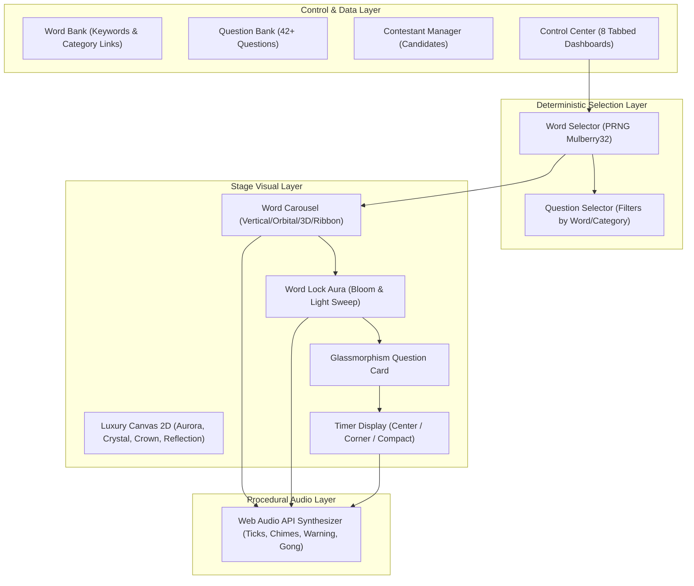

# Royal Word Spin & Luxury Pageant Edition (Version 3.0) — Technical Design Spec

## 1. Overview & Vision
The system transitions from the previous nature-only transition system to **Royal Word Spin / Luxury Pageant Edition (✦ SCi TECH TINE ✦ CHARM OF TRANSITION AMBASSADOR 2026)**.
The new centerpiece on the pageant stage is a high-class, slot-less **Royal Word Carousel** that dynamically spins through meaningful pageant keywords (Word Pool), seamlessly decelerates, locks onto a selected word with ethereal bloom and light sweep, and transitions into the final question reveal and stage timer.

---

## 2. System Architecture & Component Model



---

## 3. State Machine Flow (Version 3.0)

| State | Duration (ms) | Visual Effect | Sound Cue |
|---|:---:|---|---|
| `idle` | ∞ | Standby aurora waves, crystal dust, subtle crown silhouette, water reflection | Ambient silence |
| `pre-spin` | 800ms | Light beam converges to center, word reel ascends | Wind build-up / charge tone |
| `word-spin` | 2,500ms | Words scroll at high speed through center axis | Accelerating rhythmic ticks |
| `word-decelerate` | 2,000ms | Words progressively slow down, distinct words become visible | Decelerating resonate ticks |
| `word-lock` | 1,500ms | Target word locks in center with soft bloom, light burst & aura | Ethereal dual chime (Major chord) |
| `question-reveal` | 1,000ms | Selected word ascends to header badge, question unfolds | Harmonic reveal chord (C Maj 7th) |
| `question` | ∞ | Question text, candidate badge, stage countdown timer | Timer ticks & warning cues |
| `answered` | ∞ | Answered seal / history logged | Completion gong |

---

## 4. Word Bank & Question Mapping

### Word Entity Schema
```typescript
export interface KeywordItem {
  id: string;
  word: string;
  category: string; // rain, mist, wind, leaf, moon, star, final
  color?: string;
  englishTheme?: string;
  enabled: boolean;
  priority?: number;
}
```

### Word Bank Defaults
- `ความฝัน` (Moon - Authenticity & Empathy)
- `วิสัยทัศน์` (Mist - Vision & Perspective)
- `ภาวะผู้นำ` (Wind - Leadership & Impact)
- `ตัวตน` (Star - Character & Leadership)
- `คุณค่า` (Final - Decisive Question)
- `การปรับตัว` (Rain - Adaptability & Growth)
- `พันธกิจ` (Leaf - Purpose & Legacy)
- `แรงบันดาลใจ` (Wind - Leadership & Impact)
- `ความกล้า` (Star - Character & Leadership)
- `อนาคต` (Mist - Vision & Perspective)

---

## 5. Visual Theme Tokens (Luxury Winter Pageant)

- **Primary Canvas Background:**
  - Deep Navy: `#071126`
  - Royal Blue: `#0D2854`
  - Violet Glow: `#5B4BDB`
  - Silver Light: `#DDE7FF`
  - Soft Gold: `#F5D98A`
- **Atmospheric Layers:**
  1. `AuroraSystem`: Multi-color waving sin-gradients
  2. `CrystalSystem`: Floating 2D/3D crystal particles with blur & parallax
  3. `CrownSystem`: Translucent royal crown watermark with shimmer
  4. `ReflectionSystem`: Mirror water reflection on the lower third of the canvas

---

## 6. Procedural Audio Synthesis Extensions
- `playSpinStart()`: Lowpass whoosh + ascending pitch ramp.
- `playSpinTick(speedRatio)`: Short click/tick oscillator with pitch modulation based on deceleration speed.
- `playWordLock()`: Polyphonic major triad chime with shimmer decay.
- `playQuestionReveal()`: Harmonic C Major 7th chord.
- Existing timer tick, warning chime, and finish gong remain intact with granular toggles.
