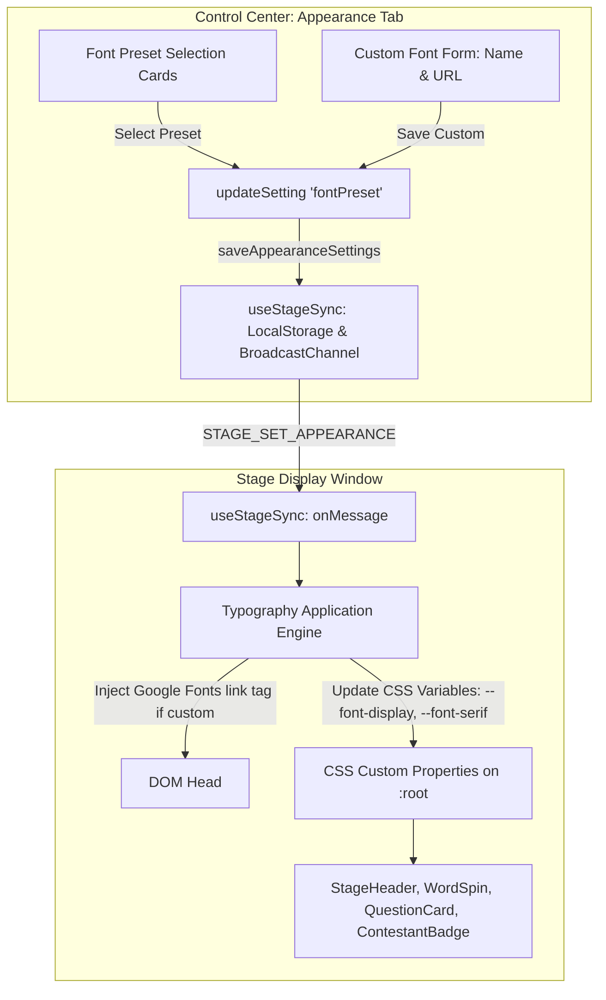

# Design Spec: Custom Typography & Font Switcher System

**Date**: 2026-09-19  
**Status**: Approved  
**Author**: AI Assistant & User  

---

## 1. Executive Summary
The Stage and Control Center currently use standard serif and sans-serif fonts (`Cinzel`, `Outfit`, `Prompt`). This feature adds a comprehensive Typography & Font Selection system that enables the pageant administrators to select curated display fonts—notably **Amoria** (by Fandi Kurniawan) and **Verve** (by Dieter Steffmann)—as well as add custom Google WebFonts from the Backstage Appearance settings panel, synchronized in real-time with the Stage view.

---

## 2. Requirements & Goals

### 2.1 Functional Requirements
1. **Curated Display Font Presets**:
   - **Cinzel** (Royal Standard Serif - default)
   - **Amoria** (Modern Luxury Serif by Fandi Kurniawan)
   - **Verve** (Ornate Heritage Display by Dieter Steffmann)
   - **Outfit** (Clean Modern Geometric Sans)
2. **Font Scope & Pairing**:
   - Support changing fonts for stage display elements (`--font-display`, `--font-serif`).
   - Guarantee 100% legibility for Thai characters by pairing every display font with `'Prompt'` fallback stack:
     ```css
     font-family: var(--font-display), 'Prompt', -apple-system, sans-serif;
     ```
3. **Backstage Control (Appearance Settings Panel)**:
   - **Preset Selector Cards** with rich live text previews in both English and Thai.
   - **Custom WebFont Adder**: Allows admin to input any Font Family name and optional Google Fonts CSS URL to load and apply custom web fonts on the fly.
   - Dynamic font injection helper to inject Google Font stylesheets into the DOM safely.
4. **Real-time Stage Synchronization**:
   - Broadcast typography changes from Control Center to Stage view seamlessly via `useStageSync` BroadcastChannel and localStorage persistence.

### 2.2 Non-Functional Requirements
- Instantaneous font switching with zero page reload or UI flicker.
- Embedded `@font-face` definitions for Amoria and Verve with high-performance WOFF2/TTF/SVG fallbacks.
- Robust error handling for invalid custom font URLs (graceful fallback to default system fonts).

---

## 3. Architecture & Data Flow



---

## 4. Component & Data Model Specifications

### 4.1 Data Model (`src/types/appearance.ts`)
```typescript
export type FontPresetId = 'cinzel' | 'amoria' | 'verve' | 'outfit' | 'custom';

export interface CustomFontConfig {
  name: string;
  fontFamily: string;
  googleFontUrl?: string;
}

export interface AppearanceSettings {
  backgroundMode?: BackgroundMode;
  themeName: 'luxury-winter-pageant' | 'ethereal-gold' | 'custom';
  spinMode: WordSpinMode;
  spinDurationMs: number;
  particleDensity: number;
  glowIntensity: number;
  showCrownSilhouette: boolean;
  showWaterReflection: boolean;
  showLightRays: boolean;
  showAurora: boolean;
  showCrystals: boolean;
  fontPreset: FontPresetId;
  customFont?: CustomFontConfig;
  customColors?: Partial<ThemeColors>;
}
```

### 4.2 Typography Map & Font Definitions
| Preset ID | Display Font Name | Author / Style | CSS Font Family Value |
|---|---|---|---|
| `cinzel` | Cinzel | Google Fonts / Royal Roman Serif | `'Cinzel', Georgia, 'Prompt', serif` |
| `amoria` | Amoria | Fandi Kurniawan / Luxury Modern Serif | `'Amoria', 'Cinzel', 'Prompt', serif` |
| `verve` | Verve | Dieter Steffmann / Ornate Gothic Heritage | `'Verve', 'Cinzel', 'Prompt', serif` |
| `outfit` | Outfit | Google Fonts / Clean Modern Sans | `'Outfit', 'Prompt', sans-serif` |
| `custom` | Dynamic | User Specified | `var(--font-custom-family), 'Prompt', sans-serif` |

### 4.3 Typography Helper (`src/utils/typography.ts`)
- `applyTypography(settings: AppearanceSettings): void`
  - Resolves active font-family string.
  - Dynamically updates `--font-display` and `--font-serif` on `document.documentElement` or `#root`.
  - Injects or updates `<link id="dynamic-google-font" rel="stylesheet">` if `customFont?.googleFontUrl` is provided.

### 4.4 Appearance Settings UI (`src/components/Control/AppearanceSettings.tsx`)
- Adds a **Typography Section (รูปแบบตัวอักษร / Typography)**:
  - 4 Preset Cards with visual previews of `"CHARM OF TRANSITION 2026"` and `"มนต์เสน่ห์แห่งรอยต่อฤดู"`.
  - Badge tags for each preset (*Royal Standard*, *Modern Luxury*, *Classic Heritage*, *Modern Sans*).
  - Custom WebFont drawer/inputs: Font Name, CSS Font Family, and Google Fonts Embed URL.

---

## 5. Error Handling & Edge Cases
1. **Network failure on Custom Google Font URL**: If Google Font URL fails to load, browser automatically renders the fallback font (`Prompt`, sans-serif/serif) without crashing.
2. **Missing glyphs for Thai text**: Amoria & Verve do not contain Thai glyphs; font stack fallback ensures Thai characters render cleanly with `Prompt` without rectangular replacement boxes (tofu).
3. **Session Rehydration**: Font settings are persisted in `localStorage` under `season_transition_appearance` and restored on page refresh or stage launch.

---

## 6. Verification & Test Plan
1. **Automated Unit Tests (`tests/appearanceTypography.test.ts`)**:
   - Verify `DEFAULT_APPEARANCE_SETTINGS` includes default `fontPreset: 'cinzel'`.
   - Verify `applyTypography` sets correct CSS variables for each preset (`cinzel`, `amoria`, `verve`, `outfit`, `custom`).
   - Verify custom font link creation and clean up.
2. **Full Test Suite & Build Verification**:
   - Run `npm test` across all test suites (ensure 100% pass rate).
   - Run `npm run build` (`tsc -b && vite build`) to ensure zero type or bundling errors.
