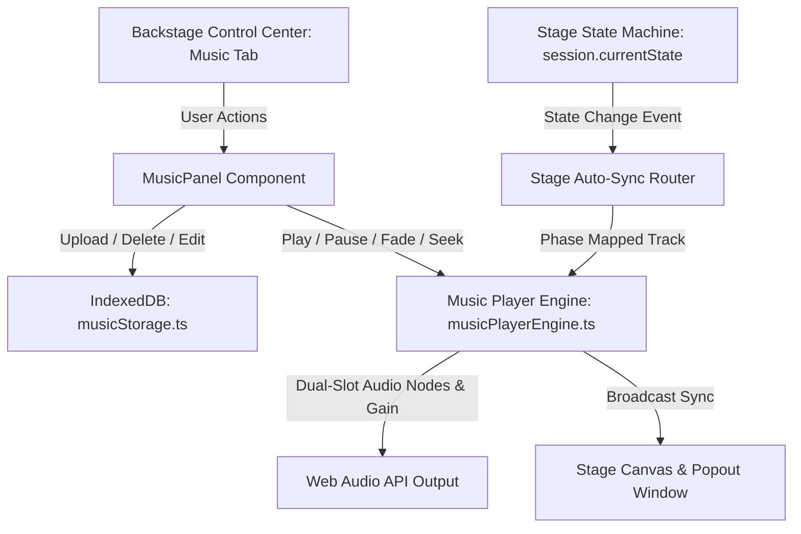

# Stage Music Control & Audio Library Management Design Spec

## 1. Executive Summary
This design specification defines the architecture, data models, audio engine, storage mechanisms, and user interface for the **Stage Music Control & Audio Management System** (`🎵 เพลงประกอบ / BGM`). 

The system provides competition operators with full control over audio playback, background music (BGM), stage phase soundtrack routing, and seamless track library management (uploading local MP3/WAV files to IndexedDB, streaming from URLs, and using built-in synthesized presets).

---

## 2. Core Architecture & System Flow



### Key Capabilities:
1. **Hybrid Track Sourcing**:
   - Local file uploads (`.mp3`, `.wav`, `.ogg`, `.aac`, `.m4a`) stored as binary Blobs in client-side IndexedDB for offline persistence.
   - Remote audio URL streams.
   - Built-in synthesized / procedural fallback presets for immediate zero-config operation.
2. **Dual-Slot Smooth Crossfading**:
   - Employs two alternating HTML5 Audio / Web Audio Gain instances (Slot A & Slot B) to execute seamless 1.0s–1.5s crossfading without clicks, pops, or abrupt cuts.
3. **Stage Phase Auto-Sync Router**:
   - Automatically switches music based on active competition stage:
     - `idle` $\rightarrow$ Ambient Stage BGM
     - `pre-spin` / `word-spin` $\rightarrow$ Word Spin Suspense Music
     - `question-reveal` / `question` $\rightarrow$ Question Thinking Music
     - `answered` $\rightarrow$ Victory / Celebration Fanfare
4. **Independent Jukebox & Manual Override**:
   - Operators can toggle Auto-Sync off and manually trigger, pause, seek, loop, or fade out any track at will.

---

## 3. Data Models & TypeScript Types

### `src/types/music.ts`

```typescript
export type AudioSourceType = 'local_blob' | 'url' | 'preset';

export type StagePhaseTarget = 'ambient' | 'spin' | 'question' | 'answered' | 'none';

export interface MusicTrack {
  id: string;
  title: string;
  artist?: string;
  sourceType: AudioSourceType;
  url?: string;
  blob?: Blob;
  duration: number; // in seconds
  defaultVolume: number; // 0.0 - 1.0
  loop: boolean;
  targetPhase?: StagePhaseTarget;
  createdAt: number;
  isPreset?: boolean;
}

export interface PhaseTrackMapping {
  ambient: string | null;   // Track ID for Idle / Ambient
  spin: string | null;      // Track ID for Word Spin
  question: string | null;  // Track ID for Question / Timer
  answered: string | null;  // Track ID for Celebration
}

export interface MusicState {
  currentTrackId: string | null;
  isPlaying: boolean;
  volume: number; // Master volume 0.0 - 1.0
  isMuted: boolean;
  currentTime: number;
  duration: number;
  autoSyncWithStage: boolean;
  phaseTrackMapping: PhaseTrackMapping;
}

export const DEFAULT_MUSIC_STATE: MusicState = {
  currentTrackId: null,
  isPlaying: false,
  volume: 0.75,
  isMuted: false,
  currentTime: 0,
  duration: 0,
  autoSyncWithStage: true,
  phaseTrackMapping: {
    ambient: 'preset-ambient-luxury',
    spin: 'preset-spin-tension',
    question: 'preset-question-focus',
    answered: 'preset-fanfare-royal'
  }
};
```

---

## 4. Storage & Persistence (`src/storage/musicStorage.ts`)

- **Database Name**: `RandomizeQuiz_MusicDB` (IndexedDB v1)
- **Object Store**: `tracks` (keyPath: `id`)
- **Metadata Store in LocalStorage**: `stage_quiz_music_state_v1` (saves volume, mute status, auto-sync setting, and phase mappings).

### Storage API Methods:
- `initMusicDB(): Promise<IDBDatabase>`
- `getAllTracks(): Promise<MusicTrack[]>`: Reads all records, creates Object URLs for Blobs, and returns hydrated `MusicTrack` items.
- `saveTrack(track: MusicTrack, fileBlob?: Blob): Promise<MusicTrack>`
- `deleteTrack(id: string): Promise<void>`
- `getTrackById(id: string): Promise<MusicTrack | null>`
- `loadDefaultPresets(): Promise<MusicTrack[]>`: Seeds high-quality synthesized presets if the library is empty.

---

## 5. Audio Player Engine & Crossfade Architecture (`src/engine/musicPlayerEngine.ts`)

```typescript
export interface PlayOptions {
  fadeInDuration?: number;  // in seconds (default 1.2s)
  startTime?: number;       // in seconds
  loop?: boolean;
}

export interface StopOptions {
  fadeOutDuration?: number; // in seconds (default 1.0s)
}
```

### Engine Behavior:
- **Active Slot vs Incoming Slot**:
  - Slot A holds currently playing track with its GainNode.
  - When `playTrack(newTrack, { fadeInDuration: 1.2 })` is called, Slot B loads the new track, starts at gain 0, and ramps up to target volume over 1.2 seconds, while Slot A ramps down to 0 and stops.
- **Audio Context Management**:
  - Automatically initializes or resumes AudioContext on first user interaction.
- **Cross-Window Sync**:
  - Emits events (`MUSIC_STATE_UPDATED`, `TRACK_CHANGED`, `PLAYBACK_TOGGLED`) via `BroadcastChannel('stage_quiz_sync_v1')`.

---

## 6. Backstage User Interface (`src/components/Control/MusicPanel.tsx`)

### UI Sections:
1. **Master Control & Auto-Sync Bar**:
   - `⚡ เล่นเพลงตามสถานะเวทีอัตโนมัติ (Auto-Sync: ON/OFF)` toggle.
   - Master volume slider (0%–100%) with mute toggle.
   - `⏹️ Smooth Fade Out All` button.
2. **Now Playing Deck**:
   - Current song badge, title, and source indicator.
   - Draggable progress bar (`01:25 / 03:40`) and time display.
   - Play/Pause, Loop, Restart buttons.
   - Real-time animated audio visualizer bar.
3. **Stage Phase Assignment Grid**:
   - 4 distinct phase cards:
     - 🏠 Ambient / Idle BGM
     - ⚡ Word Spin Tension BGM
     - 💡 Question Thinking BGM
     - 🎉 Victory Fanfare
   - Allows selecting assigned track via dropdown selector, instant play button, and unmap button.
4. **Track Library & Management Table**:
   - **Upload File Dropzone**: Drag-and-drop or file picker accepting multiple `.mp3`, `.wav`, `.ogg`, `.aac` files.
   - **Add URL Modal**: Allows entering custom audio stream URL + title.
   - **Track Table**:
     - Columns: Status, Track Title, Duration, Source Type, Phase Assignment Badge, Actions (Preview Play, Play Now, Delete with confirmation modal).
   - **Restore Defaults Button**: Re-seeds default system presets if needed.

---

## 7. Error Handling & Edge Cases
- **Audio Decoding Errors / Invalid Formats**: Graceful toast notification with fallback to default ambient audio.
- **IndexedDB Quota / Incognito Mode**: In-memory storage fallback if IndexedDB is blocked.
- **Autoplay Restrictions**: AudioContext gracefully pauses until first user gesture; UI displays friendly status badge.
- **Concurrent Phase Changes**: Smoothly cancels previous fade and ramps to new target smoothly without audio clipping.

---

## 8. Verification & Testing Plan
- **Unit Tests (`tests/musicStorage.test.ts`)**:
  - Test saving, retrieving, and deleting track Blobs in IndexedDB.
  - Test preset seeding and mapping updates.
- **Audio Engine Tests (`tests/musicPlayerEngine.test.ts`)**:
  - Test play, pause, volume ramping, and dual-slot crossfade transitions.
- **Component Tests (`tests/musicPanel.test.tsx`)**:
  - Test uploading files, toggling auto-sync, assigning phase tracks, and deleting tracks.
- **End-to-End Build & Test Suite**:
  - Confirm 100% test pass rate (`npm test`) and successful production bundle build (`npm run build`).
