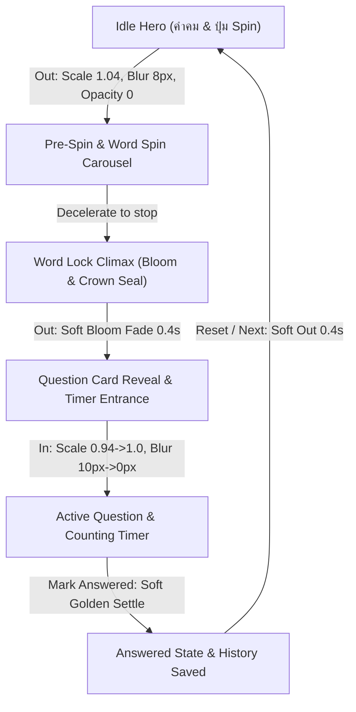

# Design Spec — Royal Cinematic Stage UI Transition Animations

## 1. Overview & Objectives
ออกแบบและพัฒนาระบบแอนิเมชันการเข้า-ออก (Entrance & Exit Transitions) ขององค์ประกอบ UI ทุกชิ้นบนหน้าจอเวที (Stage Screen) ให้มีความนุ่มนวล หรูหรา ไร้รอยต่อ และมีจังหวะการเปลี่ยนผ่านระดับการถ่ายทอดสดงานประกวด (Broadcast-Grade Pageant Experience)

---

## 2. Animation Choreography & State Lifecycle Flow



---

## 3. Detailed Component Transitions

### 3.1 Idle Hero (`StageOverlay.tsx`)
- **Entrance**: ค่อยๆ ลอยขึ้นจากด้านล่างด้วย `translateY(16px ➔ 0px)`, `opacity: 0 ➔ 1`, พร้อมประกายแสงบนปุ่ม `SPIN WORD`
- **Exit**: เมื่อเริ่มกระบวนการสุ่มคำ ตัว Idle Hero จะค่อยๆ ขยายออกพร้อมคลายความคมชัด (`scale: 1.0 ➔ 1.04`, `filter: blur(0px ➔ 8px)`, `opacity: 1 ➔ 0`) อย่างนุ่มนวล (0.45s)

### 3.2 Royal Word Lock Climax (`WordLockEffect.tsx`)
- **Entrance**: แสงรัศมีสีทองและคริสตัลออร่าขยายตัว (`scale: 0.8 ➔ 1.0`, `opacity: 0 ➔ 1`) พร้อมป้ายชื่อคำสว่างวาบ (`Bloom Pulse`)
- **Exit**: ก่อนส่งต่อไปยังการ์ดคำถาม แสงออร่าและป้ายคำจะค่อยๆ หรี่ลงอย่างนุ่มนวล (`opacity: 1 ➔ 0`, `transform: translateY(0 ➔ -12px) scale(0.98)`) ไม่ตัดภาพทันที

### 3.3 Question Card (`QuestionCard.tsx`)
- **Entrance (Staggered Crystal Reveal)**:
  - การ์ดกระจกแก้วขยายตัวจาก `scale: 0.94 ➔ 1.0`, `translateY: 20px ➔ 0px`, คลาย `blur(10px) ➔ blur(0px)` และเร่งความสว่าง `opacity: 0 ➔ 1` ภายในเวลา 0.55s ด้วย easing curve `cubic-bezier(0.16, 1, 0.3, 1)`
  - ตัวอักษรข้อความคำถามค่อยๆ ปรากฏอย่างคมชัด
- **Answered Settle**: เมื่อผู้เข้าแข่งขันตอบเสร็จ การ์ดจะเปลี่ยนเส้นขอบเป็นสีเขียวมรกต/ทองอ่อนนุ่มนวล (`border-color: rgba(34, 197, 94, 0.5)`) พร้อมประกายแสงแห่งความสำเร็จ

### 3.4 Countdown Timer Display (`TimerDisplay.tsx`)
- **Entrance**:
  - **Corner Mode**: ลอยลงมาจากมุมบนขวาพร้อมขยายตัว (`translateY: -12px ➔ 0px`, `scale: 0.92 ➔ 1.0`, `opacity: 0 ➔ 1`)
  - **Center Mode**: ลอยลงมากึ่งกลางเหนือการ์ดคำถาม พร้อมขยายแสงออร่ารอบตัวเลข (`box-shadow` และ `filter: blur(8px ➔ 0px)`)
- **Exit**: ค่อยๆ เลือนหายอย่างนุ่มนวลเมื่อเข้าสู่สถานะ `answered` หรือรีเซ็ตกลับ `idle`

### 3.5 Contestant Badge (`ContestantBadge.tsx`)
- **Entrance**: สไลด์ลงมาจากมุมบนซ้ายอย่างสง่างาม (`translateY: -18px ➔ 0px`, `opacity: 0 ➔ 1`) พร้อมเส้นแสงคริสตัลสะท้อนผ่านตัวป้าย 1 รอบ (`Glass Shimmer Sweep`)

---

## 4. CSS Keyframe Token System (`index.css`)

```css
/* Luxury Royal Smooth Easing Curves */
:root {
  --ease-royal-spring: cubic-bezier(0.16, 1, 0.3, 1);
  --ease-soft-out: cubic-bezier(0.25, 1, 0.5, 1);
  --ease-cinematic-in-out: cubic-bezier(0.65, 0, 0.35, 1);
}

/* Staggered Card Reveal Keyframe */
@keyframes stage-card-cinematic-reveal {
  0% {
    opacity: 0;
    transform: translateY(24px) scale(0.94);
    filter: blur(10px);
  }
  60% {
    filter: blur(0px);
  }
  100% {
    opacity: 1;
    transform: translateY(0) scale(1);
    filter: blur(0px);
  }
}

/* Hero Dissolve Exit */
@keyframes stage-hero-dissolve-out {
  0% {
    opacity: 1;
    transform: translateY(0) scale(1);
    filter: blur(0);
  }
  100% {
    opacity: 0;
    transform: translateY(-16px) scale(1.04);
    filter: blur(8px);
  }
}

/* Shimmer Light Sweep on Badge */
@keyframes badge-shimmer-sweep {
  0% {
    transform: translateX(-150%) skewX(-20deg);
  }
  100% {
    transform: translateX(250%) skewX(-20deg);
  }
}
```

---

## 5. Verification Plan

### 5.1 Automated Tests
- Run full test suite `npm test` (vitest) to verify all 81 tests pass.
- Verify component snapshot and rendering of `QuestionCard`, `TimerDisplay`, `ContestantBadge`, `WordLockEffect`, and `StageOverlay`.

### 5.2 Build & Runtime Verification
- Execute `npm run build` to ensure TypeScript types and production assets compile cleanly.
- Verify in browser dev server that state transitions (`idle` ➔ `pre-spin` ➔ `word-spin` ➔ `word-decelerate` ➔ `word-lock` ➔ `question` ➔ `answered` ➔ `idle`) flow with fluid 60fps glassmorphism animations.
