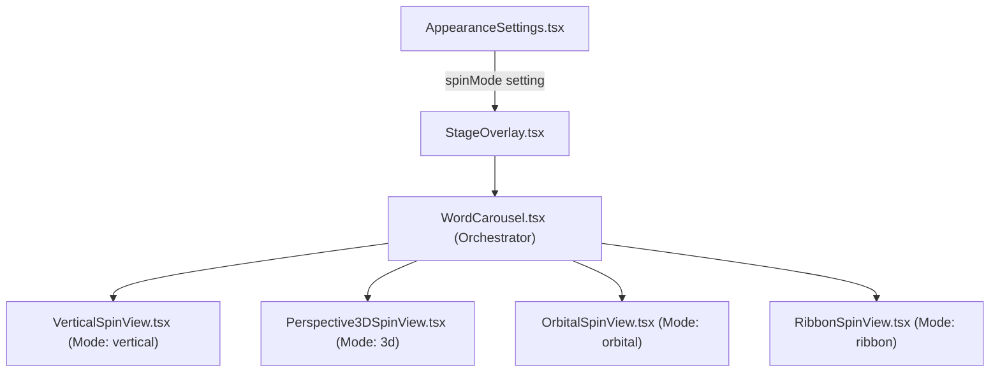

# Word Spin Modes (4 Interactive Pageant Spin Styles) — Technical Design Spec

## 1. Overview & Goal
The Pageant Stage System (**✦ SCi TECH TINE ✦ CHARM OF TRANSITION AMBASSADOR 2026**) supports 4 configurable Word Spin Modes selectable via Backstage Appearance Settings:
1. **Royal Vertical Spin (`vertical`)**: Classic vertical column reel with top/bottom diamond guide markers.
2. **3D Perspective Spin (`3d`)**: 3D perspective drum cylinder rotating along the X-axis with dynamic depth blur and scaling.
3. **Circular Orbital Words (`orbital`)**: Elliptical orbit swirling around a radiant tiara core on an inclined 3D disc plane.
4. **Royal Ribbon Spin (`ribbon`)**: Flowing horizontal glass streamer with shimmering light sweeps and royal brackets.

Currently, all 4 modes fallback to a single vertical scroll list. This design spec establishes distinct, dedicated visual renderers for each mode, providing immersive pageant-grade aesthetics and smooth 60fps animations.

---

## 2. Component Architecture



### File Hierarchy & Responsibilities:
- `src/components/Stage/WordSpin/WordCarousel.tsx`: Main container managing timing, `requestAnimationFrame` animation loop, PRNG reel, deceleration easing, sound triggers, and header/footer status badges.
- `src/components/Stage/WordSpin/types.ts`: Shared interfaces (`SpinViewProps`, `VisibleWordItem`).
- `src/components/Stage/WordSpin/VerticalSpinView.tsx`: Mode 1 renderer (Vertical Slot Reel).
- `src/components/Stage/WordSpin/Perspective3DSpinView.tsx`: Mode 2 renderer (3D Cylinder Drum).
- `src/components/Stage/WordSpin/OrbitalSpinView.tsx`: Mode 3 renderer (Circular / Elliptical Orbit).
- `src/components/Stage/WordSpin/RibbonSpinView.tsx`: Mode 4 renderer (Horizontal Glass Ribbon).

---

## 3. Detailed Visual & Mathematical Mechanics

### 3.1 Common Interface
```typescript
export interface SpinViewProps {
  reel: KeywordItem[];
  currentIndex: number;
  targetWord: KeywordItem;
  phase: 'pre-spin' | 'word-spin' | 'word-decelerate';
}
```

### 3.2 Mode 1: Royal Vertical Spin (`vertical`)
- **Layout**: Vertical track with 7 visible words centered around `currentIndex` ($\text{offset} \in [-3, +3]$).
- **Transform**: $\text{translateY} = \text{offset} \times 56\text{px}$, $\text{scale} = 1 - |\text{offset}| \times 0.12$.
- **Aesthetic**: Top/bottom diamond markers (`indicator-top`, `indicator-bottom`), center active word scaling to `2.8rem` with glowing cyan-white text-shadow and sparkle stars (`✦`).

### 3.3 Mode 2: 3D Perspective Spin (`3d`)
- **Layout**: 3D cylindrical drum with `perspective: 1000px` and `transform-style: preserve-3d`.
- **Geometry**:
  - Drum radius $R = 150\text{px}$.
  - Angular spacing $\theta = \text{offset} \times 38^\circ$ for 7 visible words ($\text{offset} \in [-3, +3]$).
  - Transform: `rotateX(${- \theta}deg) translateZ(${R}px)`.
- **Aesthetic**:
  - Distance blur: `filter: blur(${Math.abs(offset) * 2}px)` on receding words.
  - Active center word ($\theta = 0^\circ$): `blur(0px)`, luminous white glow, luxury crystal sparkle, and top/bottom cylinder vignette shading.

### 3.4 Mode 3: Circular Orbital Words (`orbital`)
- **Layout**: Elliptical orbit around a radiant central Tiara/Crystal core.
- **Geometry**:
  - 8 visible words distributed around the orbit.
  - Orbital radii: $R_x = 240\text{px}$, $R_y = 65\text{px}$ (inclined 3D disc plane).
  - Angle for word $k$: $\alpha_k = \text{baseAngle} + k \times \frac{2\pi}{8}$.
  - Position: $X = R_x \times \cos(\alpha_k)$, $Y = R_y \times \sin(\alpha_k)$.
  - Depth: Foreground words ($\sin(\alpha_k) > 0$) have scale $1.05 - 1.15$, $z\text{-index} > 10$, opacity $0.9 - 1.0$. Background words have scale $0.65 - 0.8$, $z\text{-index} < 5$, opacity $0.3 - 0.5$.
- **Aesthetic**:
  - Glowing pulsing center Tiara with subtle elliptical orbit rings.
  - Smooth landing of `targetWord` at foreground center ($X=0, Y=R_y$) when decelerating.

### 3.5 Mode 4: Royal Ribbon Spin (`ribbon`)
- **Layout**: Horizontal Glassmorphic conveyor stream with 5 visible words ($\text{offset} \in [-2, +2]$).
- **Transform**: $\text{translateX} = \text{offset} \times 220\text{px}$, $\text{scale} = 1 - |\text{offset}| \times 0.15$.
- **Aesthetic**:
  - Translucent glass ribbon banner with dual gold-cyan edge borders.
  - Shimmering light sweep wave running across the ribbon.
  - Center bracket indicators `⟨ คำสำคัญ ⟩` framing the active word.

---

## 4. State Machine & Timing Sync

| State | Duration | Animation Behavior | Audio Cue |
|---|:---:|---|---|
| `pre-spin` | 800ms | Stationary preview with idle pulse | Charge whoosh |
| `word-spin` | 2,500ms | Fast continuous cycling | Fast rhythmic ticks |
| `word-decelerate` | 2,000ms | Cubic ease-out deceleration landing on target | Decelerating resonant ticks |
| `word-lock` | 1,500ms | Locks into `WordLockEffect` | Polyphonic chime chord |

---

## 5. CSS & Styling Enhancements
- Dedicated styles added to `src/index.css` for `.mode-vertical`, `.mode-3d`, `.mode-orbital`, and `.mode-ribbon`.
- GPU acceleration with `transform`, `opacity`, and `will-change` properties for consistent 60fps performance.
- Full responsiveness on various viewport aspect ratios.

---

## 6. Verification Plan
- **Automated Tests**:
  - `tests/wordCarouselModes.test.ts`: Verify that all 4 view components render properly with target word, active classes, and distinct mode containers.
  - `npm test`: Verify all 70+ existing unit and E2E tests continue to pass.
- **Manual Verification**:
  - Verify switching each of the 4 modes in Appearance Settings and running a spin on the Stage.
