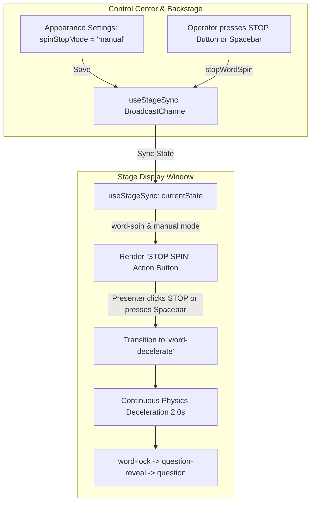

# Design Spec: Word Spin Stop Modes (Auto-Stop vs. Manual-Stop)

**Date**: 2026-09-19  
**Status**: Approved  
**Author**: AI Assistant & User  

---

## 1. Executive Summary
The Word Spin randomizer currently operates solely on a fixed timer (`word-spin` duration of 2.5s), automatically progressing to deceleration and word lock. This feature introduces a selectable Word Spin Stop Mode configured from the Backstage Appearance settings panel:
1. **Auto-Stop Mode (อัตโนมัติ)**: Automatically spins for a preset duration, then decelerates and locks the word without user intervention.
2. **Manual-Stop Mode (หยุดด้วยตนเอง)**: Spins continuously at high speed until the presenter or operator explicitly triggers the "STOP" action (via on-screen button, Control Center, or Spacebar), initiating the smooth 2.0s deceleration sequence to lock the selected keyword.

---

## 2. Requirements & User Stories

### 2.1 Functional Requirements
1. **Appearance Settings Configuration**:
   - `spinStopMode`: `'auto' | 'manual'` (default: `'auto'`).
   - `spinDurationMs`: number (applies in `'auto'` mode, default 4500ms).
   - Backstage Appearance Panel provides interactive selection cards for Auto-Stop and Manual-Stop modes with descriptions and badge indicators.
2. **State Machine & Journey Synchronization (`useStageSync.ts`)**:
   - In `'auto'` mode: `word-spin` progresses automatically to `word-decelerate` after its scheduled duration.
   - In `'manual'` mode: `word-spin` does not auto-advance; it spins continuously in `word-spin` state.
   - `stopWordSpin()` action transitions state from `word-spin` to `word-decelerate`, triggering smooth physics-based deceleration and subsequent word lock.
   - Real-time broadcast synchronization between Stage and Control Center tabs.
3. **Stage Screen UI (`StageOverlay.tsx`)**:
   - When `spinStopMode === 'manual'` and `currentState === 'word-spin'`:
     - Render an elegant, glowing crystal neon **"⏹️ STOP SPIN"** button centered below the Word Carousel.
     - Clicking the button or pressing Spacebar triggers `stopWordSpin()`.
   - In `'auto'` mode: Do not render the STOP button (maintains clean, hands-free stage aesthetic).
4. **Control Center & Drawer UI (`ControlCenter.tsx`, `ControlDrawer.tsx`, `KeyboardController.tsx`)**:
   - In `word-spin` state, main action button updates dynamically to **"🛑 STOP SPIN (หยุดการหมุนคำ) [Space]"**.
   - Keyboard shortcut `[Space]` executes `stopWordSpin()` when in `word-spin` state.

---

## 3. Architecture & Data Flow



---

## 4. Component & Data Model Specifications

### 4.1 Data Model (`src/types/appearance.ts`)
```typescript
export type WordSpinStopMode = 'auto' | 'manual';

export interface AppearanceSettings {
  backgroundMode?: BackgroundMode;
  themeName: 'luxury-winter-pageant' | 'ethereal-gold' | 'custom';
  spinMode: WordSpinMode;
  spinStopMode: WordSpinStopMode;
  spinDurationMs: number;
  particleDensity: number;
  glowIntensity: number;
  showCrownSilhouette: boolean;
  showWaterReflection: boolean;
  showLightRays: boolean;
  showAurora: boolean;
  showCrystals: boolean;
  fontPreset: FontPresetId;
  customFont?: CustomFontConfig;
  customColors?: Partial<ThemeColors>;
}
```

### 4.2 State Machine & Stage Sync Updates (`src/hooks/useStageSync.ts`)
```typescript
const stopWordSpin = useCallback(() => {
  if (session.currentState === 'word-spin') {
    broadcastState({
      ...session,
      currentState: 'word-decelerate'
    }, 'STAGE_STOP_WORD_SPIN');
  }
}, [session, broadcastState]);
```

In automated timer effect:
```typescript
if (session.currentState === 'word-spin' && session.appearanceSettings?.spinStopMode === 'manual') {
  // Do not set auto-progression timer in manual mode
  return;
}
```

---

## 5. Testing & Verification Plan
1. **Automated Unit Tests (`tests/wordSpinStopMode.test.ts`)**:
   - Verify `DEFAULT_APPEARANCE_SETTINGS` includes `spinStopMode: 'auto'`.
   - Verify state transition from `word-spin` to `word-decelerate` upon calling `stopWordSpin()`.
   - Verify that in `'manual'` mode, auto-progression timer is bypassed during `word-spin`.
2. **UI & Integration Tests (`tests/appearancePanel.test.tsx`, `tests/stageOverlay.test.tsx`)**:
   - Verify AppearanceSettings panel renders Auto-Stop and Manual-Stop mode cards.
   - Verify StageOverlay renders `STOP SPIN` button when in `word-spin` with `manual` mode.
3. **Full Suite & Build Check**:
   - Run `npm test` across all 20+ test suites (100% pass rate).
   - Run `npm run build` (`tsc -b && vite build`) to ensure 0 errors.
