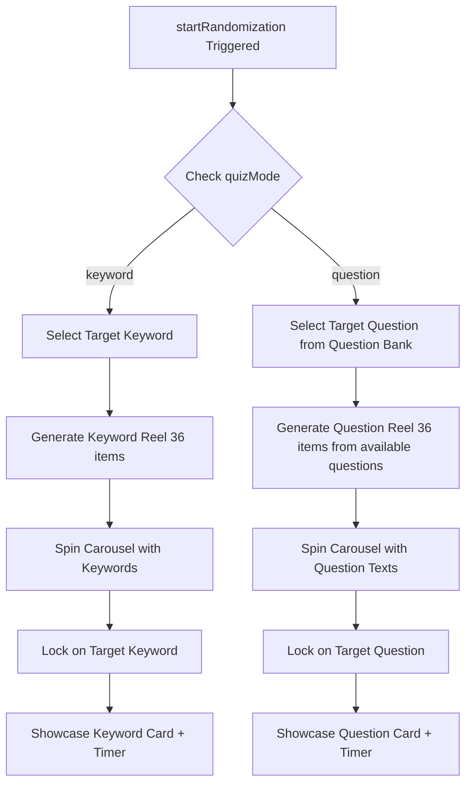

# 📜 Dynamic Question Spin Reel Design Specification

**Author**: Senior Software Architect  
**Date**: 2026-09-20  
**Status**: Draft (Awaiting Review)  
**Target Feature**: Question Mode Spin Reel & Question Lock Showcase

---

## 1. Executive Summary

In response to tournament operator requirements, the RandomizeQuiz stage application must distinguish between the two competition flows during the **Spinning** (`pre-spin`, `word-spin`, `word-decelerate`) and **Locking** (`word-lock`) phases:

1. **🏷️ Keyword Mode (`quizMode: 'keyword'`):**
   - Spins keywords (e.g. *"ความกล้า", "อนาคต", "ภาวะผู้นำ"*)
   - Locks on the chosen keyword (`✦ SELECTED KEYWORD ✦`)
   - Immediately transitions to speech countdown timer with `KeywordShowcaseCard`.

2. **📜 Question Bank Mode (`quizMode: 'question'`):**
   - Spins actual **Question Texts** from the Question Bank (e.g. *"ในยุค AI ท่านคิดว่าทักษะใดสำคัญที่สุด?", "จงอธิบายแนวคิดการพัฒนาที่ยั่งยืน..."*)
   - Locks on the chosen Question (`✦ SELECTED QUESTION ✦`)
   - Transitions to `QuestionCard` with question timer.

---

## 2. Architecture & Data Flow



---

## 3. Detailed Component Specifications

### 3.1 Generic Reel Generator (`src/engine/wordSpinEngine.ts`)
Generalize `generateSpinReel` with TypeScript generics so it supports both `KeywordItem` and `Question`:
```typescript
export interface GenericSpinItem {
  id: string;
  displayText: string;
  category?: string;
  subText?: string;
}

export function generateGenericSpinReel<T extends { id: string }>(
  allItems: T[],
  targetItem: T,
  reelLength: number = 36,
  seed?: string
): T[]
```

### 3.2 Carousel & Views Adaptations (`WordCarousel.tsx` & Spin Views)
- **`WordCarousel.tsx`**:
  - Accept either `items: GenericSpinItem[]` or polymorphic `items` with `targetItem`.
  - When spinning questions:
    - Sets item formatting class `.spin-item-question`
    - In `RibbonSpinView`: Text container handles single-line clamp with ellipsis (`max-width: 580px`, `font-size: clamp(1rem, 2.2vw, 1.35rem)`), ensuring long question sentences don't overflow the viewport.
    - In `VerticalSpinView`: Question items render with adequate spacing and line-clamp (`max-height: 80px`, `max-width: 700px`).
    - In `Perspective3DSpinView` & `OrbitalSpinView`: Center question text cleanly with cosmic glow effect.

### 3.3 Dynamic Lock Effect (`WordLockEffect.tsx`)
- Display dynamic seal:
  - When `quizMode === 'keyword'`: `✦ SELECTED KEYWORD ✦` and displays keyword name.
  - When `quizMode === 'question'`: `✦ SELECTED QUESTION ✦` and displays question text.
- Preserve luxury cosmic glassmorphism styling, radial bloom, and sparks.

### 3.4 Synchronization & State (`useStageSync.ts` & `StageOverlay.tsx`)
- In `startJourney`:
  - In question mode, pass question list (or questions pool) into the session or stage loader.
- In `StageOverlay.tsx`:
  - Passes questions to carousel if `quizMode === 'question'`, and keywords if `quizMode === 'keyword'`.

---

## 4. Verification Plan

1. **Automated Unit & Component Tests (`tests/`)**:
   - `tests/wordSpinEngine.test.ts`: Test generic spin reel generation for questions and keywords.
   - `tests/stageTransitions.test.ts`: Verify `StageOverlay` renders question text during spin when in question mode.
   - `tests/appearancePanel.test.tsx`: Verify settings persist and toggle cleanly.
2. **Build Validation**:
   - Run `tsc -b && vite build` with 0 errors.
   - Run `npx vitest run` with all suites passing.
